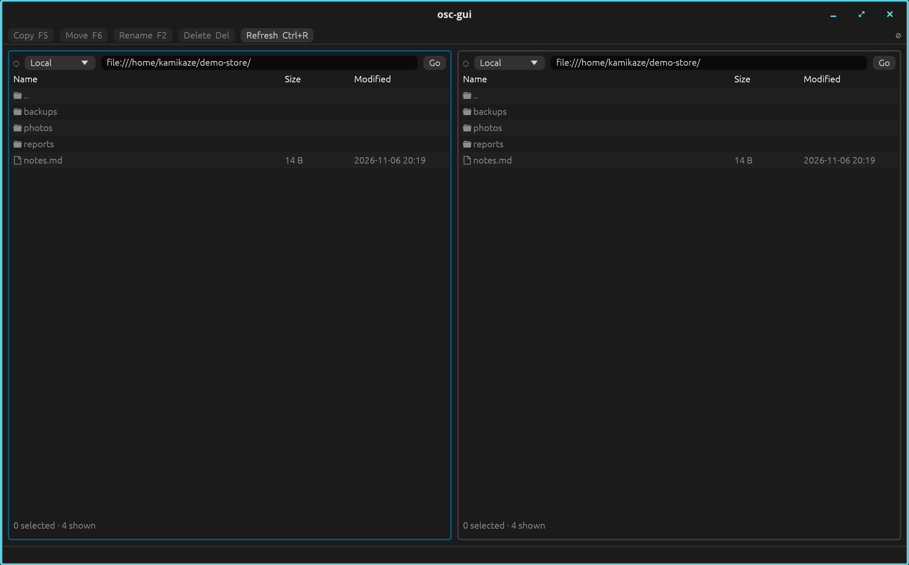

# Object Storage Client

One URL-based API for AWS S3, Google Cloud Storage, Azure Blob Storage,
HTTP(S) and the local filesystem, as a Rust library, Python bindings, the
`osc` command-line tool and the `osc-gui` desktop browser. The scheme of each
URL picks the backend, so a single client can copy and move objects between
providers, stream large objects in bounded memory (see
[Behaviour](docs/BEHAVIOR.md#large-objects-and-streaming) for the limits) and
generate pre-signed URLs. Optional client-side encryption keeps object contents
hidden from the storage provider.

- **One API for every backend**, including cross-provider copy and move.
- **Streaming** uploads and downloads, with multipart uploads for large objects.
- **Listing** of a prefix or a whole bucket (flat and recursive), existence
  checks and bucket creation.
- **Pre-signed URLs** for S3, GCS and Azure. An `s3://` URL signed with
  temporary credentials stops working when that session ends, whatever expiry
  was requested.
- **AWS profiles and SSO for `s3://`**: `osc --profile NAME`,
  `ObjectStorageClient(profile="NAME")` in Python and `with_s3_profile` in Rust;
  see [AWS profiles and SSO](docs/CONFIGURATION.md#aws-profiles-and-sso).
- **Client-side encryption** (Cargo feature `encryption`, on by default) with
  self-reloading keyrings and key rotation.

| URL                                                        | Backend                                                |
|------------------------------------------------------------|--------------------------------------------------------|
| `s3://bucket/key`                                          | AWS S3 and S3-compatible stores (Garage, SeaweedFS, …) |
| `gs://bucket/key`, `gcs://bucket/key`                      | Google Cloud Storage                                   |
| `az://`, `wasb(s)://`, `abfs(s)://` + `container/key`      | Azure Blob Storage                                     |
| `http://host/path`, `https://host/path`                    | HTTP/HTTPS                                             |
| `file:///abs/path`, `/abs/path`, `~/path`, `relative/path` | Local filesystem                                       |

For the cloud schemes the host is the bucket or container and the path is the
object key. A bucket-root URL such as `s3://bucket` addresses the bucket
itself: list it, create it or check that it exists. Credentials come from
environment variables or, for `s3://`, from a named AWS profile; see
[Configuration](docs/CONFIGURATION.md).

## Desktop browser (`osc-gui`)

`osc-gui` is a two-panel desktop browser for the same stores as `osc`. Each
panel shows one folder on its own connection, and you copy, move, rename and
delete objects and whole folders within a panel or between the two, also across
accounts and providers. It finds the connections already set up on the machine
and takes the same encryption options as `osc`.



### Install

Each [GitHub release](https://github.com/bixority/object-storage-client/releases)
has packages for both binaries:

- **macOS (Apple silicon):** open the `.dmg` and drag the app to Applications.
  The app is not signed with an Apple Developer ID, so macOS blocks it on first
  launch. Open System Settings → Privacy & Security and choose **Open Anyway**.
  The README in the `.dmg` shows how to put `osc` on your PATH.
- **Debian and Ubuntu:** `sudo apt install ./object-storage-client_<version>-1_amd64.deb`
- **Fedora and RHEL-family:** `sudo dnf install ./object-storage-client-<version>-1.x86_64.rpm`

The Linux packages install the GUI's runtime libraries (Wayland, xkbcommon,
EGL and GL) as dependencies.

Or install both binaries from the registry:

```bash
export CARGO_REGISTRIES_BIXORITY_INDEX="sparse+https://codeberg.org/api/packages/bixority/cargo/"
cargo install object-storage-client --registry bixority --features gui
```

Or from a checkout:

```bash
cargo install --path . --features gui
```

On Linux, `osc-gui` needs a Wayland session; X11 is not supported.

### Run

```bash
osc-gui                                        # both panels on Local, the current directory
osc-gui --keyring keyring                      # copies encrypt and decrypt
```

Each panel has a connection selector for Local and what is found on the
machine: AWS profiles, provider environment variables, gcloud configurations and
Azure CLI storage accounts; a cloud connection lists its buckets. Type any
matching URL or path into a panel's address bar and press Enter. Archived
objects (S3 Glacier Flexible Retrieval and Deep Archive, Azure Archive tier)
show ❄ and objects being restored show ⌛; copy, move and rename skip them and
say why.
If a connection cannot authenticate, an AWS SSO profile can log in from the
panel's error banner; for gcloud and Azure the banner shows the command to run.
The keys and shortcuts are listed in [Desktop browser](docs/GUI.md), which also
covers limits and closing behaviour.

## CLI (`osc`)

### Install

```bash
export CARGO_REGISTRIES_BIXORITY_INDEX="sparse+https://codeberg.org/api/packages/bixority/cargo/"
cargo install object-storage-client --registry bixority
# or: cargo install --git https://codeberg.org/bixority/object-storage-client
# or, from a checkout: cargo install --path .
```

### Run

```bash
osc put my_file.txt s3://my-bucket/remote_file.txt              # upload a file
osc put --recursive my_dir s3://my-bucket/remote_dir/           # upload a directory
osc get gs://my-bucket/data.json ./local_data.json              # download
osc get-stream gs://my-bucket/large_file.bin > large_file.bin   # stream to stdout; progress on stderr
osc --profile dev ls s3://my-bucket/                            # credentials from the AWS profile "dev"
osc cp s3://source-bucket/image.png az://dest-container/image.png   # copy between providers
osc mv s3://my-bucket/old_name.txt s3://my-bucket/new_name.txt
osc ls s3://my-bucket/logs/                                     # names; --url prints full object URLs
osc rm s3://my-bucket/temp_file.tmp
osc exists s3://my-bucket/report.pdf                            # prints true or false
osc mb s3://my-new-bucket                                       # create a bucket (a directory for local paths)
osc bucket-exists s3://my-bucket                                # prints true or false

# Pre-signed URLs (S3, GCS, Azure): a download link valid for the default
# 1 hour, and an upload (PUT) link valid for 15 minutes. With temporary
# credentials (SSO, an assumed role) an s3:// link stops working when that
# session ends, whatever the expiry
osc sign s3://my-bucket/report.pdf
osc sign --method PUT --expires-in 900 s3://my-bucket/upload.bin
# S3 only: the upload is rejected unless Content-Length and Content-Type match
osc sign --method PUT --content-length 1048576 \
    --content-type application/pdf s3://my-bucket/upload.pdf
```

`get-stream` writes each chunk to standard output as it arrives, so its output
is complete only if `osc` exits 0. A failed read, or a truncated or tampered
encrypted object, stops the output part way: every byte written was
authenticated, but the object may be cut short. In a pipeline use
`set -o pipefail`, or give a FILE for an all-or-nothing download.

### Encryption

With a keyring, `put`, `get`, `get-stream`, `cp` and `mv` encrypt and decrypt
transparently:

```bash
umask 077                                    # keyring files must not be readable by others
osc keyring new > keyring                    # a keyring with one fresh key
osc --keyring keyring put report.csv s3://my-bucket/report.csv
osc --keyring keyring get s3://my-bucket/report.csv report.csv
osc enc inspect s3://my-bucket/report.csv    # header details; no keys needed

# Rotation: add a key, wait until every reader has it, activate it, then move
# objects off the old one (a single reader may use `osc keyring rotate`)
osc keyring add < keyring > keyring.new && mv keyring.new keyring
osc keyring activate <new key ID> < keyring > keyring.new && mv keyring.new keyring
osc --keyring keyring enc reencrypt s3://my-bucket/ --from <old key ID>
osc enc scan s3://my-bucket/                 # objects per key ID; retire the old key only when it has none and the scan exits 0
```

`--keyring` can also come from `OSC_KEYRING_FILE`, or from a command that
prints the keyring (`OSC_KEYRING_COMMAND`), so the keyring never touches the
disk. With `--require-encryption` (or `OSC_REQUIRE_ENCRYPTION=1`), `put`, `get`,
`get-stream`, `cp`, `mv` and `sign` fail when no keyring is configured, instead
of sending or reading plaintext.

## Rust

The crate is published to the
[Bixority Codeberg crate registry](https://codeberg.org/bixority/object-storage-client):

```bash
export CARGO_REGISTRIES_BIXORITY_INDEX="sparse+https://codeberg.org/api/packages/bixority/cargo/"
```

```toml
[dependencies]
object-storage-client = { version = "0.4", registry = "bixority" }
# or: object-storage-client = { git = "https://codeberg.org/bixority/object-storage-client" }
tokio = { version = "1", features = ["full"] }
```

The `encryption` and `cli` features are on by default. A library that does not
need the CLI can drop `clap` and `tokio-util`:

```toml
object-storage-client = { version = "0.4", registry = "bixority", default-features = false, features = ["encryption"] }
```

```rust
use object_storage_client::{ObjectStorageClient, SignMethod, SignOptions};
use std::time::Duration;

#[tokio::main]
async fn main() -> Result<(), Box<dyn std::error::Error>> {
    let client = ObjectStorageClient::new();

    // Create a bucket (S3/GCS/Azure, or a directory for file:// URLs); success if it is already yours
    client.create_bucket("s3://my-bucket").await?;

    // Upload data to S3
    client.put("s3://my-bucket/hello.txt", &b"Hello from Rust!"[..]).await?;

    // Download it back
    let retrieved = client.get("s3://my-bucket/hello.txt").await?;
    println!("Retrieved: {}", String::from_utf8_lossy(&retrieved));

    // Stream a large object in bounded memory: the download feeds the upload
    let stream = client.get_stream("s3://my-bucket/hello.txt").await?;
    client.put_stream("file:///tmp/hello_copy.txt", stream).await?;

    // List the whole bucket from a bucket-root URL (flat, recursive: every key
    // is returned). Pass a prefix such as "s3://my-bucket/logs/" to narrow it.
    let keys = client.list("s3://my-bucket").await?;
    println!("Bucket keys: {keys:?}");

    // Existence checks (missing -> Ok(false), never an error)
    if client.bucket_exists("s3://my-bucket").await? {
        println!("my-bucket is present");
    }
    if client.exists("s3://my-bucket/hello.txt").await? {
        println!("hello.txt is present");
    }

    // --- Move data across providers with one client ---

    // Copy S3 -> Google Cloud Storage (source is left in place)
    client
        .copy("s3://my-bucket/hello.txt", "gs://my-gcs-bucket/hello.txt")
        .await?;

    // Move GCS -> Azure Blob Storage (source is deleted afterwards)
    client
        .move_object("gs://my-gcs-bucket/hello.txt", "az://my-container/hello.txt")
        .await?;

    // Copy Azure -> local disk for a working copy
    client
        .copy("az://my-container/hello.txt", "file:///tmp/hello_local.txt")
        .await?;

    // --- Pre-signed URLs: time-limited, credential-free access (S3/GCS/Azure) ---

    // Pre-signed download (GET) link, valid for one hour
    let download_url = client
        .get_pre_signed_url(
            "s3://my-bucket/hello.txt",
            SignMethod::Get,
            Duration::from_secs(3600),
            &SignOptions::default(),
        )
        .await?;
    println!("Share this download link: {download_url}");

    // Pre-signed upload (PUT) link binding the exact size and type the client
    // must send (S3 only); the store rejects mismatched uploads up front.
    let upload_url = client
        .get_pre_signed_url(
            "s3://my-bucket/upload.bin",
            SignMethod::Put,
            Duration::from_secs(900),
            &SignOptions {
                content_length: Some(1_048_576),
                content_type: Some("application/octet-stream".to_string()),
            },
        )
        .await?;
    println!("Upload directly to: {upload_url}");

    Ok(())
}
```

With encryption, the same calls on an encrypting view:

```rust
use object_storage_client::encryption::{EncryptionConfig, Keyring};
use object_storage_client::ObjectStorageClient;
use std::sync::Arc;

let keyring = Arc::new(Keyring::from_file("/var/run/secrets/osc/keyring")?); // reloads itself
let secure = ObjectStorageClient::new().with_encryption(EncryptionConfig::new(keyring.clone()));

secure.put("s3://my-bucket/payroll.csv", &b"id,salary"[..]).await?; // only ciphertext is stored
let csv = secure.get("s3://my-bucket/payroll.csv").await?;          // authenticated before it is returned
let health = keyring.status(); // active key, key ages, last reload error
```

## Python

The package is published on [PyPI](https://pypi.org/project/object-storage-client/)
and needs Python 3.13.9 to 3.15:

```bash
pip install object-storage-client
```

Wheels exist for GIL CPython 3.13-3.15 on manylinux x86_64/aarch64, macOS arm64
and Windows x86_64; other platforms build the sdist and need Rust 1.99 or
newer. Free-threaded CPython is unsupported: 3.13t does not build, and on 3.14t
and later importing the module re-enables the GIL with a `RuntimeWarning`.

```python
import asyncio
from object_storage_client import ObjectStorageClient

async def main():
    client = ObjectStorageClient()

    # Create a bucket (S3/GCS/Azure, or a directory for file:// URLs); success if it is already yours
    await client.create_bucket("s3://my-bucket")

    # Check whether a bucket exists (returns a bool; never raises for a miss).
    if await client.bucket_exists("s3://my-bucket"):
        print("my-bucket is present")

    # Upload data to S3
    await client.put_object("s3://my-bucket/hello.txt", b"Hello from Python!")

    # Check whether an object exists (returns a bool; never raises for a miss).
    # If you prefer the missing case to raise FileNotFoundError, use
    # get_object_metadata() or get_object() instead.
    if await client.object_exists("s3://my-bucket/hello.txt"):
        print("hello.txt is present")

    # Fetch full metadata (raises FileNotFoundError if the object is missing)
    meta = await client.get_object_metadata("s3://my-bucket/hello.txt")
    print(f"Size: {meta['size_bytes']}, type: {meta['content_type']}")

    # Download data
    data = await client.get_object("s3://my-bucket/hello.txt")
    print(f"Retrieved: {data.decode()}")

    # List objects
    items = await client.list_objects("s3://my-bucket/")
    print(f"Bucket items: {items}")

    # List a large prefix in bounded batches
    async for names in await client.list_objects_stream("s3://my-bucket/"):
        print(f"{len(names)} more items")

    # Stream data
    stream = await client.get_object_stream("s3://my-bucket/hello.txt")
    async for chunk in stream:
        print(f"Chunk size: {len(chunk)}")

    # Stream an upload from any async iterable of bytes (size_hint= is optional);
    # a ByteStream from get_object_stream is piped natively
    await client.put_object_stream(
        "s3://my-bucket/hello-copy.txt",
        await client.get_object_stream("s3://my-bucket/hello.txt"),
    )

    # --- Move data across providers with one client ---

    # Copy S3 -> Google Cloud Storage (source is left in place)
    await client.copy_object("s3://my-bucket/hello.txt", "gs://my-gcs-bucket/hello.txt")

    # Move GCS -> Azure Blob Storage (source is deleted afterwards)
    await client.move_object("gs://my-gcs-bucket/hello.txt", "az://my-container/hello.txt")

    # Copy Azure -> local disk for a working copy
    await client.copy_object("az://my-container/hello.txt", "file:///tmp/hello_local.txt")

    # --- Pre-signed URLs (S3/GCS/Azure): credential-free, time-limited access ---

    download_url = await client.get_pre_signed_url("s3://my-bucket/hello.txt")
    # Bind the exact Content-Length and Content-Type the client must send (S3
    # only); the store rejects uploads that don't match.
    upload_url = await client.get_pre_signed_url(
        "s3://my-bucket/upload.bin",
        method="PUT",
        expires_in_secs=900,
        content_length=1_048_576,
        content_type="application/octet-stream",
    )
    print(f"Download: {download_url}\nUpload: {upload_url}")

if __name__ == "__main__":
    asyncio.run(main())
```

With encryption (key bytes never reach Python):

```python
from object_storage_client import ObjectStorageClient, Keyring

keyring = Keyring.from_file("/var/run/secrets/osc/keyring")    # reloads itself
secure = ObjectStorageClient().with_encryption(keyring)
# or directly: EncryptedObjectStorageClient(keyring, profile="dev")  # profile= is optional

await secure.put_object("s3://my-bucket/payroll.csv", b"id,salary")  # only ciphertext is stored
data = await secure.get_object("s3://my-bucket/payroll.csv")         # authenticated before it is returned
health = keyring.status()  # active key, key ages, last reload error
```

## Documentation

- [Configuration](docs/CONFIGURATION.md): credentials and environment variables
  for each provider.
- [Encryption](docs/ENCRYPTION.md): what it protects, keyrings, Kubernetes, key
  rotation, responding to a key leak, the format and interop.
- [Behaviour and limits](docs/BEHAVIOR.md): URL rules, copy and move, deletes,
  archived objects, file permissions, large objects, pre-signing, CLI and
  Python details.
- [Desktop browser](docs/GUI.md): `osc-gui`, its keys, limits and closing.
- [Upgrading](docs/UPGRADING.md): breaking changes between releases.
- [Development](docs/DEVELOPMENT.md) and [Testing](docs/TESTING.md).
