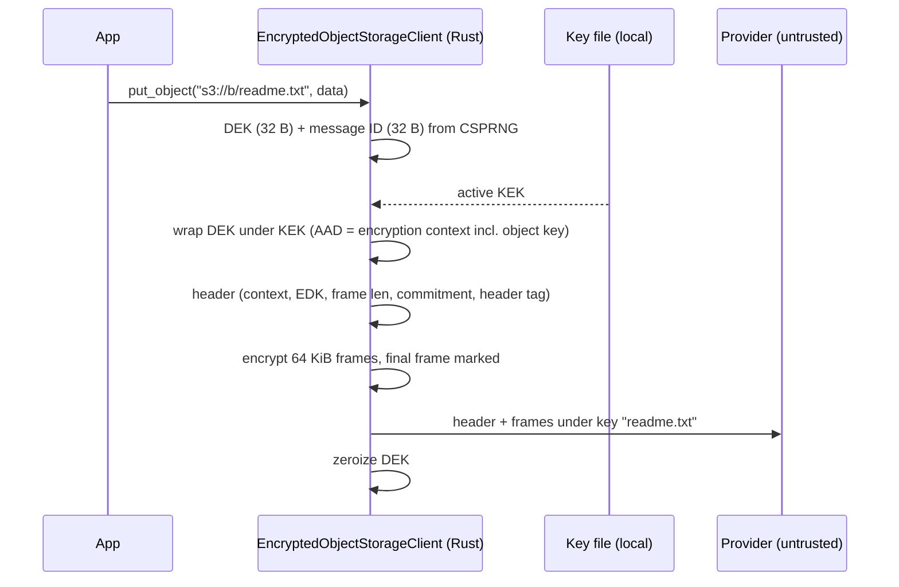

# Client-side encryption for object-storage-client — design spec

- **Status:** **Approved** 2026-10-26 and implemented in 0.2.0 (decisions D16–D19, default `encryption` feature and CLI streaming confirmed in Q&A). Corrected against the code (v0.1.19, `main` @ `d82f7cc`; `src/` is identical to `64ef3d5`, which is where the exploration ran) on 2026-10-26. The original draft was produced in a claude.ai session that could not read `src/` or `python/`; §3 now records what the code actually does, and the sections it affects are corrected in place.
- **Scope:** Phase 1 (MVP). Phases 2–3 are listed only so Phase 1 does not paint us into a corner.
- **Location in repo:** `docs/superpowers/specs/2026-10-26-client-side-encryption-design.md`

## 0. Corrections to the original draft (historical)

1. **Two pre-existing bugs block the design** and are fixed first (new milestone 0, §11): Python `async for` over `ByteStream` never terminates (verified), and the store cache can build two backends for one (scheme, host) under concurrency.
2. **No streaming upload exists** anywhere (library, Python or CLI). `put_stream` is new work, built on `object_store`'s `put_multipart` + `WriteMultipart`, with our own abort-on-drop guard because S3/GCS/Azure multipart uploads have no `Drop` abort.
3. **Cross-provider and EXDEV-fallback `copy`/`move` buffer the whole object in memory today.** Phase 1 does not change plain behaviour, but the encrypted client's copy path streams.
4. **`get_stream` yields `object_store::Result<Bytes>`.** A decrypting stream needs the crate's own error type, so the item type changes to `crate::Result<Bytes>`: a breaking Rust API change (→ 0.2.0).
5. **`list` returns relative keys only** (`Vec<String>`), not sizes or timestamps. The §8 "listed sizes are stored sizes" row is moot, and the D15 listing-based inventory needs a new metadata-listing API (Phase 2).
6. **`pyo3-async-runtimes`' `into_stream_v2` is unusable for `put_object_stream`:** a Python exception in the input iterator looks like a clean EOF on the Rust side, which would commit a truncated object. We pull `__anext__` manually.
7. **D10:** `LocalFileSystem` rejects any `attributes` on put and multipart (`NotImplemented`), so we cannot set Content-Type on `file://`. Corrected to "set no attributes".
8. **D9:** for `file://`, the bound `osc:key` is the full absolute path, so local ↔ cloud copies never keep the binding.
9. **No Python tests exist** (no pytest, CI never builds or imports the extension). Python test infrastructure is part of milestone 0.
10. Missing from the draft's API lists: Python `delete_object` and `get_pre_signed_urls`, and Rust `delete`, `delete_by_prefix`, `get_object_metadata` and `get_pre_signed_urls`. `get_pre_signed_urls` is plain-only, like `get_pre_signed_url`.

---

## 1. Goal, threat model, non-goals

**Goal.** Optional client-side envelope encryption:
- Each object is encrypted with a fresh per-object data key (DEK) before it leaves the process.
- The DEK is wrapped with a key-encryption key (KEK) that exists only on infrastructure the user controls.
- The format is identical on every backend (S3, GCS, Azure, HTTP, local FS).
- Existing code using `ObjectStorageClient` behaves exactly as today.

**Threat model.** The storage provider is untrusted: it can read, modify, truncate, reorder, swap, delete and roll back stored bytes, and it sees all request metadata. Provider-side encryption (SSE-S3, SSE-KMS, SSE-C) is **not** relied on, because the provider can read data under all of them.

**Non-goals (Phase 1), documented as limitations:**
- hiding object names (listing returns original keys such as `readme.txt`);
- hiding sizes, timestamps or access patterns;
- detecting rollback or deletion by the provider;
- protecting plaintext on a compromised client;
- zeroizing plaintext held in Python `bytes`.

---

## 2. Verified repository facts (code at v0.1.19 / `d82f7cc`)

- **Version:** `Cargo.toml` 0.1.19, latest tag `v0.1.19` (a version bump plus a lockfile refresh over `64ef3d5`).
- **API model:** URL-based API, one `ObjectStorageClient` across s3/gs/az/http/file. Cross-provider copy and move, pre-signed URLs (S3/GCS/Azure), streaming reads, the `osc` CLI.
- **Credentials:** from the environment on first backend use, never from constructor arguments. The bucket comes from the URL host.
- **Rust:** edition 2024, `rust-version = "1.99"` (README says 1.98+ and pins 0.0.36; both stale).
- **Lints:** `unsafe_code = "forbid"`, clippy pedantic + nursery, `unwrap_used = "deny"`, `enum_glob_use = "deny"`. CI: `cargo test --all-features` on stable/beta/nightly, `cargo fmt --check`, `cargo clippy --all-targets --all-features -D warnings`.
- **Dependencies (locked):** `object_store 0.14.2` (aws, gcp, azure, http), **`ring 0.17.14` (direct; used today only in `sign.rs` for `digest` + `hmac`)**, `async-trait`, `dashmap 6`, `bytes`, `futures`, `futures-util`, `tokio` (full), `thiserror 2`, `clap 4`, `reqwest 0.13` (rustls), `chrono`; `pyo3 0.30.1` + `pyo3-async-runtimes 0.30.0` (`tokio-runtime`) behind the `python` feature. Dev: `tempfile`, `tokio` test-util.
- **Python packaging:** maturin, `python-source = "python"`, native module `object_storage_client._object_storage_client`, CPython `>=3.13.9,<3.15`. (CI builds wheels for 3.14 and 3.15, which contradicts `<3.15`. Unrelated to this work; noted only.)
- **Python methods:** `put_object(url, data: bytes | list[int])`, `get_object`, `get_object_stream` → `ByteStream` (async iterator + `next()`), `get_object_metadata` → dict (`location`, `last_modified`, `size_bytes`, `content_type`, `e_tag`, `version`), `object_exists`, `list_objects` → `list[str]`, `copy_object`, `move_object`, **`delete_object`**, `delete_objects_by_prefix`, `create_bucket`, `bucket_exists`, `get_pre_signed_url(url, method=, expires_in_secs=, content_length=, content_type=)`, **`get_pre_signed_urls(urls, …)`**.
- **Rust methods:** `ObjectStorageClient::new()`, `get`, `get_stream` → `BoxStream<'static, object_store::Result<Bytes>>`, `put<D: Into<Bytes>>`, `delete`, `delete_by_prefix`, `list` → `Vec<String>`, `get_object_metadata` → `ObjectMetadata`, `exists`, `create_bucket`, `bucket_exists`, `copy`, `move_object`, `get_pre_signed_url(url, SignMethod, Duration, &SignOptions)`, `get_pre_signed_urls(&[&str], …)`. Also `#[doc(hidden)] pub` `parse_url`, `get_backend`, `get_store`, which the functional tests use.
- **Tests:** `tests/{unit,functional,integration}.rs` with submodules. Baseline: 30 pass; 6 ignored (the S3 integration tests need Garage). **No Python tests exist** and CI never imports the extension.
- **License:** GPL-3.0-only. **Local services:** `compose.yml` runs Garage v2.4.1 (S3-compatible) + a web UI.
- **`object_store` 0.14:** 7 required + 3 provided trait methods; convenience methods are in `ObjectStoreExt`.

## 3. Baseline at v0.1.19 (before this work; historical)

This section describes the code as it was before 0.2.0. The `ByteStream` EOF bug and the registry race listed here are fixed in 0.2.0, and `src/python.rs` is now `src/python/`.

1. **Store registry** (`src/client.rs:66-181`).
   - `ObjectStorageClient { stores: Arc<DashMap<(String, Option<String>), Arc<dyn Backend>>>, client: reqwest::Client }`, with `#[derive(Clone, Default)]`. Clones already share the cache.
   - `Backend` (`src/backend/mod.rs`, a private module) wraps `Arc<dyn ObjectStore>` plus the native bucket and signing operations. The cache key is (scheme, host); `backend::build(url)` reads provider config from the environment.
   - URL → (backend, `Path`) is resolved in `get_backend`. For `file://` the `Path` is the **whole absolute path** (`url.path()`); for other schemes it is the URL path with the leading `/` stripped.
   - **Race:** `get_backend` does `get` then `insert`, so concurrent first use of one (scheme, host) builds two backends and the last insert wins. This is functionally harmless but breaks the §10.7 "only one backend store" assertion. Fix it with the `entry()` API (milestone 0).
   - **Decision:** extract `StoreRegistry { stores, http: reqwest::Client }` behind one `Arc`. Views share it (D14).
2. **Byte seams** (all in `src/client.rs`).
   - **Write:** only `put` → `store.put(path, payload)` (one request). The copy/move fallbacks also call `to_store.put` with the whole object.
   - **Read:** `get` (`store.get().bytes()`), `get_stream` (`store.get().into_stream()`), and the copy/move fallbacks.
   - **Describe:** `get_object_metadata` (`get_opts { head: true }`, Content-Type from attributes); `exists` (`store.head`).
   - **Copy:** if the (scheme, host) pair matches, `store.copy` (server-side) with an `"os error 18"` (EXDEV) fallback to in-memory get + put. Across providers: **whole object in memory**, get + put. `move_object` works the same way with `rename`, or get + put + delete.
3. **Python streaming** (`src/python.rs:32-125`).
   - `ByteStream` holds `Arc<tokio::Mutex<Pin<Box<dyn Stream>>>>`. Each `__anext__` / `next()` call is one `future_into_py` that pulls **one** item. There is no channel, so items are pulled on demand and back-pressure reaches the network read naturally. Each chunk is copied (`to_vec()`).
   - **Bug (verified with a probe against a `maturin develop` build):** at EOF `__anext__` resolves to `None` instead of raising `StopAsyncIteration`, so `async for` yields `None` forever. `next()` returns `b""` at EOF, which is consistent with its docs. This must be fixed before any streaming pipe works from Python.
4. **Uploads.**
   - **There is no streaming or multipart upload anywhere.** `osc put` does `fs::read` (the whole file) then `put`; recursive upload runs 8 concurrent whole-file puts. `osc get` also buffers the whole object.
   - `object_store` 0.14.2 offers `put_multipart(_opts)` + `WriteMultipart`: default 5 MiB chunks, `wait_for_capacity(n)`, `finish`, `abort`.
   - **LocalFS** multipart writes a staged temp file and renames it on `complete`. Its `Drop` deletes the staged file.
   - **S3/GCS/Azure** multipart uploads have **no `Drop` abort**: a dropped upload leaks an incomplete multipart upload (on S3 it is billed until aborted or expired by a lifecycle rule). Our guard must spawn `abort()` on drop.
   - **HttpStore** `put_multipart` returns `NotImplemented`.
   - LocalFS `put_opts` and `put_multipart_opts` return `NotImplemented` whenever `attributes` is non-empty (affects D10).
5. **Listing shape:** `list` / `list_objects` returns `Vec<String>` / `list[str]` of keys **relative to the prefix**, with no sizes or timestamps.
6. **Errors.**
   - `client::Error` has these variants: `ObjectStore(#[from])`, `InvalidUrl(#[from])`, `Io(#[from])`, `UnsupportedScheme`, `SigningUnsupported`, `BucketCreationUnsupported`, `BucketExistenceUnsupported`, `Generic(String)`.
   - Python mapping: `ObjectStore(NotFound)` → `FileNotFoundError`; everything else → `RuntimeError(str)`. No custom Python exception classes exist yet.
   - Stream items use `object_store::Error`; see the `get_stream` signature change in §7.
7. **Python surface.**
   - `python/object_storage_client/__init__.py` re-exports `ObjectStorageClient` and `ByteStream` from the native module, defines the `ObjectMetadata` TypedDict, and lists them in `__all__`.
   - `__init__.pyi` holds the stubs and `py.typed` is present.
   - New classes and exceptions must be added to the re-exports, `__all__` and the stubs.
   - The native pyclass is the Rust struct `python::ObjectStorageClient` (not `PyObjectStorageClient`).
8. **Cancellation** (read from `pyo3-async-runtimes` 0.30.0 `generic.rs`).
   - `future_into_py` spawns the future wrapped in `Cancellable`. A done-callback on the asyncio future sends on a oneshot when Python cancels, and the Rust future is **dropped on its next poll**. Drop is therefore prompt at any `.await`, but not inside a long synchronous section (another reason for the ≈1 MiB CPU cap in §9).
   - Milestone 5 still adds an explicit test.
   - **Input streams:** `into_stream_v2` (feature `unstable-streams`) yields `Py<PyAny>` with **no error channel**. If the Python iterator raises, the glue task dies, the sender drops, and the Rust stream ends **as if cleanly**, which would commit a truncated object. It also prefetches up to 10 items (`mpsc(10)`). **Decision:** pull `__anext__` manually and convert each awaitable with `pyo3_async_runtimes::tokio::into_future`. `StopAsyncIteration` → end of stream; any other exception → error → abort.
9. **CLI** (`src/cli.rs`, binary-only via `mod cli` in `main.rs`).
   - clap derive: `Cli { command: Commands }`, with no global args today.
   - `Cli::run` builds `ObjectStorageClient::new()`, and each subcommand helper takes `&ObjectStorageClient`.
   - Errors are `CliError::Storage(#[from] StorageError)` plus local I/O variants.

**Other observations:**
- There is a stray paste in the `bucket_exists` doc comment (`client.rs:428`, "excsynthia-pipelineept"). Fix it in passing.
- `put<D: Into<Bytes>>` doesn't accept `&[u8]` (only `&'static`), so the §7 usage example is corrected.

---

## 4. Decisions

| # | Decision | Rationale |
|---|---|---|
| D1 | Wire format = strict **profile of the AWS Encryption SDK (ESDK) message format v2**, suite **`0x0478`** (AES-256-GCM, HKDF-SHA512, key commitment, unsigned), **framed**, **Raw-AES-keyring-compatible** EDKs | Documented, multi-language, envelope with multiple EDKs, authenticated encryption context, per-frame auth with a final-frame marker, key commitment. Data is recoverable with official ESDKs (e.g. Python) without `osc`. |
| D2 | Implement natively on **`aws-lc-rs`**; do **not** depend on the `aws-esdk` crate | `aws-esdk` (Rust) has no streaming and pulls in aws-sdk-kms, aws-sdk-dynamodb and a Dafny runtime. `aws-lc-rs` is already compiled in through `object_store` and `rustls`, so using it adds nothing to the build, and its AES-GCM picks VAES/AVX-512 code at runtime (about twice `ring`'s throughput per core on Zen 5). The first implementation used `ring`; it was replaced before the 0.2.0 release. |
| D3 | Do **not** wrap `anda_object_store`; borrow ideas (§12) | Single static key with no DEK/KEK or key IDs; two backend objects per logical object; single-writer contract + GC; roll-forward-only format; extra dependencies. |
| D4 | **Encryption is a property of the client type.** `ObjectStorageClient` always stores and returns raw bytes (unchanged). `EncryptedObjectStorageClient` always encrypts on write and decrypts/verifies on read. **No per-call flags, no URL scopes** | Call sites stay clean. Encrypted-only code receives the encrypted type, and the type system enforces it. |
| D5 | Both types are **one generic struct** `Client<C: Codec>` with type aliases; each operation is implemented **once**; the codec supplies the encryption-specific behaviour at the byte seams | Avoids duplicating put/get/copy/multipart logic. `Plain` is an identity codec, so the plain client is unchanged. |
| D6 | Mode-specific methods live in mode-specific `impl` blocks: `get_pre_signed_url` only on plain; `inspect_encryption` only on encrypted | Unsupported operations don't exist on the wrong type (compile error in Rust, `AttributeError` in Python), instead of raising at runtime. |
| D7 | **get/put are the whole API.** The encrypted client's `get`/`get_stream` transparently decrypt and verify; `put`/`put_stream` transparently encrypt. Moving data between modes is just a stream pipe between the two views (`plain.put_stream(dst, secure.get_stream(src))`). No special cross-mode methods. `put_stream` commits only if the input stream ends without error, so a failed decryption never produces a destination object | One way to do things. Streams keep memory bounded for any object size. |
| D8 | The encrypted client **never falls back to plaintext**: reading a non-OSC object raises `NotEncryptedError`. Legacy plaintext is read with the plain view, or migrated by piping it into the encrypted view | Automatic fallback is a downgrade attack surface. |
| D9 | **Bind the object key** (the `object_store` `Path` string that `get_backend` resolves: the key within the bucket, *not* the bucket or provider) into the encryption context; on by default | Stops the provider swapping ciphertexts between names, while same-key cross-bucket and cross-provider copies stay valid. **For `file://`, the `Path` is the full absolute filesystem path**, so local ↔ cloud copies always change the key and take the re-encrypt path. Documented as a limitation. |
| D10 | Provider metadata on encrypted objects: **set no `attributes`** (no Content-Type, no user metadata); no plaintext checksums | The provider sees and can modify all provider metadata; plaintext checksums are equality oracles. `object_store` sets no Content-Type unless one is configured, so providers apply their binary default. LocalFS rejects any attributes, so setting `application/octet-stream` explicitly would break `file://`. |
| D11 | Randomness only from `aws_lc_rs::rand` (AWS-LC `RAND_bytes`) | A per-thread CTR-DRBG seeded from the OS. It mixes in RDRAND/RNDR on every call where the CPU has it (AWS-LC ignores RDRAND on AMD before Zen 3) and reseeds after a fork (`MADV_WIPEONFORK`; where fork detection is unavailable it reseeds on every call). Without RDRAND, a VM restored from a snapshot can repeat output until the next reseed (documented). Internal failures abort the process instead of returning an error. The async runtime itself does not survive a fork: every Python entry point checks the pid that started it and raises `RuntimeError` in a child forked after first use. |
| D12 | Key material is loaded **by Rust from file paths**; key bytes never cross into Python | Python memory can't be zeroized. |
| D14 | **Mixed use is a first-class case.** Plain and encrypted clients can share one store registry (one set of connections and credentials): `plain.with_encryption(...)` and `secure.without_encryption()` return views over the same registry. A standalone `EncryptedObjectStorageClient(...)` constructor exists for encrypted-only processes | Apps routinely store some data encrypted and some deliberately unencrypted, in the same or different storage. Views keep each call site unambiguous without duplicating connections. |
| D15 | **Rotation = switch the active key; no routine re-wrap.** Old keys stay decrypt-only until nothing uses them. Any write through the encrypted client (including copies) uses the active key. Full re-encryption happens only after a suspected key compromise | Re-wrapping costs a GET + PUT per object (egress for large objects, request fees for many small ones) for little security gain. Envelope encryption already limits each key to data written while it was active. |
| D13 | Object names stay plaintext | Name encryption breaks prefix listing and external tooling. If ever needed: opaque IDs + an encrypted index. |
| D16 | `get_stream` yields `crate::Result<Bytes>` instead of `object_store::Result<Bytes>` on **both** client types; release as **0.2.0** | A decrypting stream must report `Decryption` / `NotEncrypted` errors. Smuggling them through `object_store::Error::Generic` would lose the typed variants. The CLI keeps compiling (`StorageError::from` is reflexive). |
| D17 | New Python exceptions: `EncryptionError(RuntimeError)` → `DecryptionError`, `UnknownKeyError`, `NotEncryptedError` | Today every non-NotFound error is a `RuntimeError`, so existing `except RuntimeError` handlers keep working. |
| D18 | `put_stream` strategy: buffer up to one part (default 8 MiB). If the input ends first, issue **one `put`** (no multipart for small objects); otherwise `WriteMultipart` with `max_concurrency` (default 4) and an abort-on-drop guard. **HTTP** (no multipart): buffer the whole input, then one `put`; documented as unbounded memory | Keeps request counts and cost unchanged for small objects; bounded memory everywhere except the `http(s)://` scheme (generic HTTP/WebDAV `HttpStore`), which has no multipart primitive. |
| D19 | Fix the two pre-existing bugs (`ByteStream` EOF, registry race) and add Python test infrastructure (pytest + `maturin develop` in CI) **before** the refactor, as their own small PR | The pipe semantics in D7 depend on correct Python stream termination, and there is currently no Python test harness to prove anything in §10. |

---

## 5. Data flow



```mermaid
sequenceDiagram
    participant App
    participant OSC as EncryptedObjectStorageClient (Rust)
    participant Keys as Key file (local)
    participant Store as Provider (untrusted)
    App->>OSC: get_object("s3://b/readme.txt")
    OSC->>Store: GET (streamed)
    Store-->>OSC: header + frames
    OSC->>OSC: parse header with limits; suite 0x0478, framed; osc:key == "readme.txt"
    Keys-->>OSC: KEK by key name
    OSC->>OSC: unwrap DEK, derive key, check commitment + header tag
    OSC->>OSC: verify + decrypt each frame (seq order, final frame, no trailing bytes)
    OSC-->>App: plaintext (only after the final frame verifies)
    Note over OSC,App: any failure → DecryptionError, no plaintext returned
```

---

## 6. Encrypted object format — "OSC profile v1"

> **Normative byte layouts come from the ESDK specification and official test vectors**, not from this document: the Raw AES keyring `provider_info` layout, frame IV construction, key-derivation and commitment info strings, header authentication. This section fixes which parts of ESDK we use and reject.

```
HEADER   version          0x02
         algorithm_id     0x0478
         message_id       32 bytes, CSPRNG (HKDF salt)
         encryption_ctx   sorted UTF-8 pairs, authenticated, NOT secret
                            "osc:fmt" = "1"
                            "osc:key" = <object key, object_store Path string>   (when bind_object_key)
                            + caller pairs (reject keys starting "osc:" or "aws-crypto-", ASCII case-insensitive)
         edk_count        1..=EDK_LIMIT
         edk[i]           provider_id   = "osc-file"            (ESDK key namespace)
                          provider_info = key name + wrap params (Raw AES keyring layout)
                          ciphertext    = AES-256-GCM(KEK, DEK; AAD = serialized encryption_ctx)
         content_type     0x02 (framed)
         frame_length     65536 (writer default)
         suite_data       32-byte key commitment
         header_auth      16-byte tag
BODY     regular frame:   seq(4) | iv(12) | ct(frame_length) | tag(16)
         final frame:     0xFFFFFFFF | seq(4) | iv(12) | len(4) | ct(len) | tag(16)
         nothing after the final frame (unsigned suite → no footer)
```

**Writer rules**
- Always suite `0x0478`, framed, one EDK in Phase 1, the reserved context entries above.
- One DEK and one message ID per object, never reused. A message-level retry MUST generate a new DEK and message ID. A transport-part retry re-sends identical ciphertext bytes and is safe.
- Emit regular frames eagerly. The final frame carries the remainder, which may be zero-length when the plaintext is an exact multiple of the frame length (both forms are valid ESDK). The ESDK reference writer itself uses the zero-length-final-frame form (confirmed by the oracle vectors); marking the last full frame as final is the other valid form.

**Reader rules** — reject *before allocating* on:
- any suite other than `0x0478` (non-committing, signed, v1);
- non-framed content;
- `edk_count > EDK_LIMIT` (default 8);
- `frame_length` outside `[4 KiB, 4 MiB]` (configurable cap);
- missing or unknown `osc:fmt`;
- `osc:key` mismatch with the requested object (when binding is on);
- non-sequential sequence numbers, a missing final frame, or trailing bytes.

**No header re-wrap or re-bind (corrected 2026-10-27).** The draft relied on a "re-wrap property": frame AAD excludes EDKs and context, so a new header could be attached to the old body. That is **unsafe** in message format v2. The header tag is AES-GCM under the per-message derived key with a **fixed all-zero IV**, so a second header (new EDKs or a new `osc:key`) under the same `(DEK, message_id)` reuses the GCM nonce with different AAD. Anyone holding both headers can recover the GHASH key and forge header and frame tags for that message (Joux's "forbidden attack"). Rule: **one header tag per `(DEK, message_id)`, ever.** Any change to EDKs or context means a full re-encrypt with a fresh DEK and message ID.

**Overhead.** About 32 bytes per 64 KiB frame (≈0.05%), plus a header of roughly 250–300 bytes plus the object-key length (one EDK, minimal context), plus 8 extra bytes on the final frame. For tiny objects this fixed ~300 B dominates: a 1 KiB file grows by about 30%. Writers must keep the header lean (short key IDs, no optional context pairs by default). Request counts are unchanged: an encrypted put/get is still one request.

**Plaintext size from stored length.** With H = header length, F = frame length and B = total − H:
- n = ⌊(B − 40)/(F + 32)⌋ and r = (B − 40) mod (F + 32), which must satisfy r ≤ F;
- plaintext = n·F + r.

This value is *unauthenticated* until the final frame is verified.

**Nonces and key-use limits**
- The per-message key is HKDF-derived with the random message ID as salt. Frame IVs are deterministic, which is safe only because the key is unique per message.
- KEK wrapping uses a random 96-bit IV under a long-lived key, so it is subject to the NIST SP 800-38D random-IV bound. Rotate KEKs far below ~2^32 wraps. `FileKeyProvider` keeps a per-process counter of wraps with the active key, readable through `FileKeyProvider::wraps()` (Rust) and `FileKeyProvider.wraps` (Python). Nothing logs or persists it, so it restarts with every process: operators must rotate KEKs (for example on a schedule) well below 2^32 wraps counted across all processes.

---

## 7. Rust architecture

### Generic client

```rust
/// Today's `stores` DashMap + `reqwest::Client`, extracted from `ObjectStorageClient`.
pub(crate) struct StoreRegistry {
    stores: DashMap<StoreKey, Arc<dyn Backend>>,   // populated via entry() — one backend per key
    http: reqwest::Client,
}
pub struct Client<C: Codec = Plain> {
    registry: Arc<StoreRegistry>,   // shared by every clone and view made from one client
    codec: C,
}
pub type ObjectStorageClient = Client<Plain>;              // existing name and API unchanged
pub type EncryptedObjectStorageClient = Client<Envelope>;

type ByteStream = BoxStream<'static, Result<Bytes>>;       // crate::Result (D16)

pub trait Codec: sealed::Sealed + Clone + Send + Sync + 'static {
    // write seams
    async fn encode(&self, loc: &Location, data: Bytes) -> Result<Bytes>;          // `put`: Plain = identity → still one store.put
    fn encode_stream(&self, loc: &Location, plain: ByteStream) -> ByteStream;      // `put_stream` (feeds the part uploader)
    // read seam (`get` collects it; Plain::get keeps today's `GetResult::bytes()` fast path)
    fn decode(&self, loc: &Location, stored: BoxStream<'static, object_store::Result<Bytes>>) -> ByteStream;
    // metadata seam (Plain: today's HEAD; Envelope: one ranged GET, §8)
    async fn describe(&self, backend: &dyn Backend, loc: &Location) -> Result<ObjectMetadata>;
    // copy/move seam (Plain: today's copy/rename + EXDEV + cross-provider in-memory paths, unchanged)
    async fn copy(&self, src: &Resolved, dst: &Resolved, delete_source: bool) -> Result<()>;
}
```

Where `Location` = the parsed URL + resolved `Path` (the `osc:key` binding), and `Resolved` = (`Arc<dyn Backend>`, `Location`).

The hook names and signatures are still a **sketch**. They now follow the real seams in §3.2. The plan fixes them exactly.

- **`Plain`:** identity hooks. `copy` keeps today's behaviour exactly: server-side when the (scheme, host) pair matches, otherwise the in-memory fallbacks, both unchanged in Phase 1. Static dispatch means no runtime cost and no behaviour change. The exception is the D16 stream item type.
- **`Envelope`:** holds `Arc<dyn KeyProvider>` + `EncryptionConfig` and calls the I/O-free core.
- **Trait style:** native `async fn` in the trait is fine with static dispatch. If `Send` bounds get awkward, use `async-trait` (already a dependency).

### Where methods live

```rust
impl<C: Codec> Client<C> {
    // written once: put, put_stream, get, get_stream, get_metadata, list, exists, delete,
    // delete_by_prefix, copy, move_object, create_bucket, bucket_exists
    pub async fn get_stream(&self, url: &str) -> Result<BoxStream<'static, Result<Bytes>>>;
    pub async fn put_stream<S>(&self, url: &str, data: S) -> Result<()>
    where S: Stream<Item = Result<Bytes>> + Send + 'static;
}
impl Client<Plain> {
    pub fn new() -> Self;
    pub async fn get_pre_signed_url(/* unchanged */);
    pub async fn get_pre_signed_urls(/* unchanged */);
    pub fn with_encryption(&self, cfg: EncryptionConfig) -> Client<Envelope>; // same registry
}
impl Client<Envelope> {
    pub fn new(cfg: EncryptionConfig) -> Self;   // standalone, own registry
    pub fn without_encryption(&self) -> Client<Plain>;                       // same registry
    pub async fn inspect_encryption(&self, url: &str) -> Result<EncryptionInfo>; // header only, no keys needed
}

pub struct EncryptionConfig {
    pub key_provider: Arc<dyn KeyProvider>,
    pub bind_object_key: bool,   // default true
    pub frame_length: u32,       // default 65536
    pub limits: DecodeLimits,
}
```

**Compatibility.**
- `ObjectStorageClient` becomes a type alias. `ObjectStorageClient::new()`, `Clone`, `Default` and all method calls compile unchanged; rustdoc will show the generic struct. The `#[doc(hidden)]` helpers `parse_url`, `get_backend` and `get_store` stay, because the tests use them.
- The **one** intentional break is D16: the `get_stream` item type.
- New code sits behind cargo feature **`encryption`**, which is added to `[tool.maturin] features` and covered by CI's `--all-features`. With the feature off, `Client<Plain>` is the only instantiation.
- The CLI binary is built from the same crate. It needs `required-features` or `cfg` gating for `--keys`. **Decided:** `encryption` is a default feature, so `cargo install` gets it; library users can opt out with `default-features = false`.

### Rust usage (target API)

```rust
use std::sync::Arc;
use object_storage_client::{Error, ObjectStorageClient, encryption::{EncryptionConfig, FileKeyProvider}};

let plain = ObjectStorageClient::new();                                   // unchanged
let keys = Arc::new(FileKeyProvider::open("/etc/osc/keys", "kek-2026-10-3f9a1b2c")?);
let secure = plain.with_encryption(EncryptionConfig::new(keys));          // shares the store registry

secure.put("s3://data/payroll.csv", payroll.clone()).await?;             // encrypted (put takes D: Into<Bytes>)
plain.put("s3://data/robots.txt", robots.clone()).await?;                // unencrypted on purpose
let csv = secure.get("s3://data/payroll.csv").await?;                     // verified plaintext
let stream = secure.get_stream("s3://data/big.parquet").await?;           // decrypting stream
plain.put_stream("file:///tmp/big.parquet", stream).await?;              // plaintext copy, bounded memory
secure.put_stream("s3://data/old.csv", plain.get_stream("s3://legacy/old.csv").await?).await?; // migrate

if let Err(Error::NotEncrypted { url }) = secure.get("s3://data/robots.txt").await { /* read with `plain` */ }

// encrypted-only service: EncryptedObjectStorageClient::new(EncryptionConfig::new(keys))
// require encryption at compile time:  fn store_payroll(c: &EncryptedObjectStorageClient, ..)
// generic code:                        async fn backup<C: Codec>(c: &Client<C>, ..)
```

- **`Codec` is sealed.** Users can write generic code over it but cannot implement it, so no custom codec can quietly weaken encryption.
- **`EncryptionConfig::new(keys)`** sets the defaults: `bind_object_key = true`, `frame_length = 65536`, default `DecodeLimits`. Builder methods override them.
- **Names to fit to the real code:** `FileKeyProvider::open` and the new error variants (`NotEncrypted`, `Decryption`, `UnknownKey`, …) are proposals. Integrate them with the existing error enum (§3.6).

### I/O-free crypto core (`encryption` module)

- **`Encryptor`:** `new(..) -> (header: Bytes, Self)`, `update(&mut self, &[u8], &mut BytesMut)`, `finish(self, &mut BytesMut)`. **Not `Clone`**; `finish` consumes it.
- **`Decryptor`:** Header → Frames → Done state machine. `feed(Bytes) -> Result<Progress>`; `finish(self) -> Result<()>` fails if the final frame is absent.
- **`HeaderCodec`:** parse/serialize with `DecodeLimits`.
- **`FrameLayout`:** plaintext ↔ ciphertext ranges and plaintext size (range reads are Phase 2, but the type belongs in the core).

### Keys

```rust
#[async_trait]
pub trait KeyProvider: Send + Sync + std::fmt::Debug {
    fn namespace(&self) -> &str;                                        // "osc-file"
    async fn wrap(&self, dek: &DataKey, ctx: &EncryptionContext)
        -> Result<Vec<EncryptedDataKey>, KeyError>;                     // >1 EDK reserved for escrow/migration
    async fn unwrap(&self, edks: &[EncryptedDataKey], ctx: &EncryptionContext)
        -> Result<DataKey, KeyError>;
}
pub struct DataKey(zeroize::Zeroizing<[u8; 32]>); // no Clone / Debug / Serialize
```

`async` is deliberate: future providers (KMS, Vault Transit, PKCS#11) are network calls.

**`FileKeyProvider`**
- Loads every `*.key` file in a directory. All loaded keys can decrypt; exactly **one explicitly configured** key ID is used for writes.
- Unix: refuse files that are group- or world-accessible or not owned by the effective UID. The key directory must be private too: refuse it (on open and before generating into it) when it is group- or world-writable or not owned by the effective UID, since anyone who can write to it can delete or rename keys or plant `*.key` entries that make loading fail.
- Key file format:

  ```
  osc-kek-v1
  id=kek-2026-10-3f9a1b2c
  created=2026-10-26
  material=<64 hex chars, 32 random bytes>
  check=<16 hex chars = first 8 bytes of HMAC-SHA256(material, "osc-key-check-v1")>
  ```

- On load, verify `check`, and verify that `id` ends with the first 8 hex characters of `check` (key names can't be reused for different material).
- The key ID is written as the EDK key name.

**Separation.** Storage credentials stay in the environment (unchanged). KEKs live in a different path, with a different owner and backup domain.

**Rotation policy (D15).**
1. Generate the new key and deploy it to **all readers** first.
2. Switch the writers' active key. New writes use it; old objects keep decrypting with the old key, which stays loaded as decrypt-only.
3. Never re-wrap routinely. Old keys retire when the inventory shows no remaining objects, typically through natural rewrites and bucket lifecycle expiry. Then move the key to offline backup rather than deleting it (bucket versions and backups may still need it).
4. **Inventory without per-object GETs.** Because every write and every copy through the encrypted client uses the active key, an object's `last_modified` from a plain listing (one request per ~1000 objects) tells which key era it belongs to. `osc enc inventory --verify-sample N` reads a sample of headers to confirm. (The provider can lie about timestamps; inventory is an operational tool, not a security check.) *Today's `list` returns keys only (§3.5), so this needs a new metadata-listing API. Both are Phase 2.*
5. **Suspected compromise:** re-encrypt affected objects with fresh DEKs (full transfer) and purge old versions. Re-wrapping alone is insufficient.

**New dependencies:** `zeroize` (runtime); `proptest` (dev); `cargo-fuzz` target (separate crate). Python ESDK only as a CI test oracle.

---

## 8. Python API

```python
from object_storage_client import ObjectStorageClient, EncryptedObjectStorageClient, FileKeyProvider

plain = ObjectStorageClient()                       # unchanged; always raw bytes
secure = plain.with_encryption(                     # encrypted view over the SAME stores/connections
    FileKeyProvider("/etc/osc/keys", active="kek-2026-10-3f9a1b2c"),
    bind_object_key=True,
)
# encrypted-only process:   secure = EncryptedObjectStorageClient(FileKeyProvider(...))
# and back again:           plain  = secure.without_encryption()   # same stores
# several key domains:      tenant_a = plain.with_encryption(FileKeyProvider("/keys/a", active=...))
#                           tenant_b = plain.with_encryption(FileKeyProvider("/keys/b", active=...))

await secure.put_object("s3://payroll/readme.txt", data, context={"tenant": "acme"})
data = await secure.get_object("s3://payroll/readme.txt")     # returned only after full verification
async for chunk in await secure.get_object_stream(url): ...   # frame-verified; truncation raises at the end
meta = await secure.get_object_metadata(url)
info = await secure.inspect_encryption(url)                   # header only; needs no keys

await secure.put_object_stream("s3://payroll/big.bin", chunks)  # any async iterable of bytes; encrypted on the fly
await secure.copy_object(src, dst)                             # encrypted → encrypted

# between modes = pipe the views (bounded memory, any size)
await plain.put_object_stream("file:///tmp/readme.txt", await secure.get_object_stream("s3://payroll/readme.txt"))
await secure.put_object_stream("s3://payroll/old.csv", await plain.get_object_stream("s3://legacy/old.csv"))

await plain.put_object("s3://public/robots.txt", data)        # plaintext, as today
```

**`get_object_metadata` on the encrypted client** returns:
- `size_bytes`: plaintext size implied by the stored length (§6);
- `stored_size_bytes`;
- `encrypted: True`;
- `encryption: {format: "osc-esdk2-0478-v1", message_id, key_names, frame_length, context}`.

**Bindings.** Two `#[pyclass]` wrappers: the existing `python::ObjectStorageClient` (inner type becomes `Arc<Client<Plain>>`) and a new `python::EncryptedObjectStorageClient`, both exposed under their Python names. The `ByteStream` pyclass is reused for both clients; its inner stream item becomes `crate::Result<Bytes>` and its error mapping goes through `client_to_py_err`. A single `macro_rules!` emits the **entire** `#[pymethods]` block containing the shared methods, plus each class's extras passed in as tokens. (pyo3's attribute doesn't process methods produced by a macro call *inside* the block. The alternative is pyo3's `multiple-pymethods` feature, which adds a dependency.) Add type stubs for both classes and `FileKeyProvider`.

**Exceptions** (all derive from `EncryptionError`, which subclasses `RuntimeError` (D17); created with `pyo3::create_exception!` and re-exported from `__init__.py`):
- `DecryptionError` — tamper, auth failure, truncation, binding mismatch;
- `UnknownKeyError` — names the key ID only; derived from unauthenticated header data, so it may also indicate tampering;
- `NotEncryptedError` — the encrypted client read a non-OSC object; read it with the plain view or migrate it by piping into the encrypted view.

Missing objects still raise `FileNotFoundError`. Messages and `Debug` output never contain key material or plaintext.

### Operation semantics on `EncryptedObjectStorageClient`

| Operation | Behaviour |
|---|---|
| `put_object` | Encrypt, then upload through the shared put path |
| `get_object` | Decrypt the stream; return only after `Decryptor::finish()` succeeds |
| `get_object_stream` | Yield each frame after its tag verifies; raise at the end on truncation. Docs must say data is provisional until the iterator ends cleanly |
| `get_object_metadata` | **One** ranged GET of the first 4 KiB (`get_opts` with a range). `GetResult.meta.size` gives the total stored size; a tiny object comes back whole. If the header is longer than 4 KiB (large context or several EDKs), make one more ranged GET up to the header limit. No separate HEAD. Content-Type, e-tag, version and last_modified come from the same `GetResult` |
| `object_exists`, `delete_object`, `delete_objects_by_prefix`, `list_objects`, `create_bucket`, `bucket_exists` | Same as plain (`list_objects` returns keys only, §3.5) |
| `copy_object` / `move_object`, same object key (in practice only cross-bucket or cross-provider, since a copy within one bucket always changes the key) | If the source is wrapped by the **active** key: validate the header (range read), then byte copy (server-side when the (scheme, host) pair matches, as today). If it is wrapped by an older key: decrypt and re-encrypt it with a fresh DEK and message ID under the active key (streamed), so every new object is on the active key. Re-wrapping only the header is forbidden (§6). Cross-provider byte copies **stream** (`get_stream` → `put_stream`) instead of today's whole-object buffering |
| `copy_object` / `move_object`, different object key (includes every `file://` ↔ cloud copy, D9) | Stream: decrypt + re-encrypt with a new DEK. Header-only re-bind is never possible (§6). A move deletes the source only after the destination commits |
| `put_object_stream` | Accept plaintext chunks of any size; buffer into 64 KiB frames, encrypt, and upload per D18 (single put if it fits in one part, otherwise multipart parts ≥ 5 MiB with bounded in-flight parts). Commit only when the input ends cleanly; abort on error or cancellation |
| `get_pre_signed_url`, `get_pre_signed_urls` | **Not present** |

**New on both clients:** `put_object_stream(url, chunks)` (Python) / `put_stream` (Rust), following D18. The plain client's `put_stream` simply skips the encoding step.

**CLI** (`src/cli.rs`).
- `--keys DIR --key-id ID` become new **global** clap args on `Cli` (today it has only the subcommand). An env equivalent is allowed for the *directory* only, never as an implicit enable. With them, `Cli::run` builds `plain.with_encryption(..)` instead of the plain client.
- The subcommand helpers become generic over `&Client<C>`. `sign` is rejected when keys are given.
- With `--keys`, the existing `put`/`get`/`get-stream`/`cp`/`mv` encrypt and decrypt transparently. `put` and `get` switch to `put_stream`/`get_stream` from and to the file, so memory is bounded. **Decided:** the plain path switches too, because its output is byte-identical; `get` writes to a temp file and renames it only after a clean end.
- Phase 1 adds `osc keys generate|check` and `osc enc inspect`.

---

## 9. Async / streaming requirements (Phase 1)

- **CPU work:** AES-GCM per frame runs inline on tokio workers, but cap the work between await points (≈1 MiB). Large in-memory payloads are encrypted in batches or via `spawn_blocking`.
- **Back-pressure:** no unbounded buffering between the provider stream, the `Decryptor` and Python; back-pressure must reach the network read.
- **Memory:** `get_object` keeps today's memory profile plus at most one frame of working buffer.
- **No resumption:** never persist or resume encryption state across retries or processes.
- **Download streams:** chunks are verified plaintext frames (≤ 64 KiB), not network chunks. Truncation or tampering raises at the point it is detected; earlier chunks were authentic but the object as a whole is unproven until the stream ends.
- **Upload streams:** memory ≈ part size × (in-flight parts + 1). Nothing becomes visible in the store until the final multipart complete (or local temp-file rename). Any error, including one raised by the *input* stream, aborts the upload. This is what makes `plain.put_stream(dst, secure.get_stream(src))` safe.
- **Python input streams:** `put_object_stream` pulls from a Python async iterable with back-pressure. Rust calls `__anext__`, awaits it via `pyo3_async_runtimes::tokio::into_future`, and only then asks for the next item. There is no prefetch. `StopAsyncIteration` is the only clean end; any other exception aborts the upload. `into_stream_v2` is **not** used (§3.8). It is a Rust stream built on `futures::stream::unfold`, so a `ByteStream` returned by `get_object_stream` is accepted like any other async iterable. Optionally, a Rust fast path can detect `ByteStream` and pipe the inner Rust stream directly, without a round-trip through Python.
- **Cancellation:** cancelling a Python task drops the Rust future at its next await (§3.8) without leaking plaintext buffers. For uploads, the abort guard spawns `abort()` (test it).

---

## 10. Test requirements

1. **Interop:** decrypt official ESDK test vectors for suite `0x0478` + Raw AES keyring if they exist. Otherwise generate vectors with the official Python ESDK. In CI, round-trip with the Python ESDK as a **dev-only** oracle, both directions.
2. **Tampering:**
   - flip every byte of every header field and of every frame field;
   - truncate small messages at **every** offset and large ones at frame boundaries;
   - append bytes; reorder, duplicate and drop frames; splice frames across messages; swap headers;
   - swap the `osc:key` binding;
   - downgrade the suite or content type;
   - oversized `edk_count`, `frame_length` and context.
3. **Keys:** wrong key; unknown key name; same name with different material; bad file permissions; bad key-directory permissions (group/world-writable or not owned by the effective user, on open and on generate); bad `check`.
4. **Property tests** (`proptest`): round-trip with random input and output chunking, including empty plaintext and exact multiples of the frame length (both final-frame encodings).
5. **Fuzzing:** a `cargo-fuzz` target for `HeaderCodec::parse` and `Decryptor::feed`.
6. **Randomness:** no repeated DEK or message ID across ≥10^6 encryptions, including parent and child after `os.fork()` from Python.
7. **Both clients:** shared test suites run against `Client<Plain>` and `Client<Envelope>`. The plain run proves existing behaviour is unchanged. Also test **mixed use**: plain and encrypted views of one registry writing concurrently to the same bucket (only one backend store is created); the plain view reading an encrypted object returns ciphertext; the encrypted view reading a plaintext object raises `NotEncryptedError`; two encrypted views with different key directories can't read each other's objects (`UnknownKeyError`).
8. **Integration:** InMemory / LocalFS first, then Garage (`compose.yml`). Add Azurite and a GCS emulator for cross-provider copies.
9. **Golden files:** commit Phase 1 ciphertexts; every future version must decrypt them.
10. **Leak checks:** no key bytes in `Debug`, `Display`, logs or error strings.

**External cryptographic review before a stable release:** the profile and reader limits, the header parser, key-file handling, the one-header-tag-per-message rule (§6), and the threat-model docs.

---

## 11. Phase 1 task outline (input for the implementation plan)

Each milestone must leave `main` green. Turn each into file-level tasks once §3 is resolved.

0. **Pre-work: bugs and Python test harness (own PR, D19).**
   - `ByteStream.__anext__` raises `StopAsyncIteration` at EOF.
   - `get_backend` uses `DashMap::entry` so there is exactly one backend per key.
   - Fix the `client.rs:428` doc typo.
   - Add `tests/python/` (pytest + pytest-asyncio or plain `asyncio.run`) covering the existing Python API against `file://`, and a CI job running `maturin develop` + pytest.
   - *Done when:* the new Python tests pass in CI, there is a regression test for the EOF bug, and a concurrency test asserts one backend per key.
1. **Generic client refactor (no behaviour change except D16).**
   - Extract `StoreRegistry`; introduce sealed `Codec`, `Plain`, `Client<C>` and the type alias. Move existing operations into `impl<C: Codec> Client<C>`, routed through the seams.
   - Change the `get_stream` item type to `crate::Result<Bytes>` and update `cli.rs` and `python.rs`.
   - Bump to 0.2.0.
   - *Done when:* all existing Rust and Python tests pass unchanged (apart from the D16 type), and a shared test harness can run any suite against a `Client<C>`.
1b. **Streaming upload on the generic client.**
   - `put_stream` per D18: single-put fast path, `WriteMultipart` with bounded concurrency, an abort-on-drop guard (spawned `abort()`), and HTTP buffering.
   - Python `put_object_stream` pulls `__anext__` manually (§9).
   - *Done when:*
     - a stream whose input errors midway leaves **no** destination object on LocalFS and InMemory, and no pending multipart upload on Garage;
     - a Python iterator that raises aborts the upload;
     - a plain `put_object_stream(dst, await plain.get_object_stream(src))` round-trips;
     - memory stays bounded for a multi-GB synthetic stream.
2. **Crypto core.** `HeaderCodec` + `DecodeLimits`, `Encryptor`, `Decryptor`, `FrameLayout` on `aws-lc-rs`. *Done when:* §10 items 1 (Rust side), 2, 4 and 5 pass.
3. **Keys.** `DataKey`, `EncryptedDataKey`, `KeyProvider`, `FileKeyProvider` (file format, permissions, check value), Raw-AES-compatible wrap/unwrap. *Done when:* §10 item 3 passes and wrap/unwrap interoperates with the ESDK vectors or oracle.
4. **Envelope codec + encrypted client (Rust).**
   - `Envelope`, `EncryptionConfig`, `EncryptedObjectStorageClient::new`, `with_encryption` / `without_encryption` (shared registry).
   - All operations in §8's table, including the decrypting `get_stream`, the encrypting `encode_stream` feeding milestone 1b's `put_stream`, the streaming copy/move paths, and `inspect_encryption`.
   - *Done when:* §10 items 7 and 8 (InMemory/LocalFS + Garage) pass, plus pipe tests: a tampered or truncated source piped into `put_stream` leaves **no** destination object, and peak memory stays bounded for a multi-GB stream.
5. **Python bindings.** Shared-methods macro, `PyEncryptedObjectStorageClient`, `FileKeyProvider`, exceptions, stubs. *Done when:* pytest covers the §8 API, cancellation (§3.8), the fork test (§10.6) and the Python ESDK round-trip.
6. **CLI.** `--keys` / `--key-id`, `keys generate|check`, `enc inspect`, transparent `put`/`get`/`get-stream`/`cp`/`mv` with `--keys`, `sign` rejected with keys. *Done when:* CLI integration tests pass against LocalFS and Garage.
7. **Docs and golden files.** README section covering setup, key handling and backups, and the limitations in §13. Commit golden files (§10.9).

## 12. Phase 2–3 (context only)

- **Phase 2:**
  - range reads (header cache keyed by URL + ETag, optional final-frame length check);
  - `download_to_file` (temp file + rename after the final frame);
  - `enc inventory` (listing-based, optional header sampling) and `enc reencrypt` for the compromise case, with conditional writes;
  - bulk migration tooling (pipe plain → encrypted across a prefix, with conditional writes).
- **Phase 3:**
  - KMS / Vault / PKCS#11 providers;
  - offline escrow EDK (RSA-OAEP; needs a new dependency);
  - an `ObjectStore` adapter for Arrow/DataFusion (consider Parquet modular encryption);
  - only if a policy ever forces retiring a still-used key: an intermediate key layer (root rotation rewrites one small keys file) (S3 `UploadPartCopy` with a new header is ruled out: it re-tags the same message keys, §6). Neither is needed for routine rotation (D15). An intermediate layer also becomes worthwhile with a network key service (KMS, HSM), to avoid one remote call per tiny object;
  - optional encrypted metadata.

**Ideas borrowed from `anda_object_store` (MIT):**
- chunk-aligned verified range reads;
- HEAD that never touches the payload;
- hard limits enforced before parsing;
- multipart part size decoupled from the crypto chunk size (≥ 5 MiB);
- uploader lifecycle states with drop guards;
- a fault-injection store for crash and cancellation tests;
- strict mode against downgrades.

## 13. Known leaks and limitations (must be in user docs)

**Visible to the provider:**
- object names, sizes, timestamps;
- access patterns;
- the header's encryption context (including the object key) and KEK key names.

**Not detectable:**
- rollback and deletion by the provider;
- swaps between objects with the **same object key** in different buckets or providers written under the same keys (the binding covers the key within the bucket, not the bucket or provider, D9); with `bind_object_key` off, swaps between any two objects under the same keys.

**Key compromise is also an integrity failure:** suite `0x0478` is unsigned, so anyone holding a loaded KEK can forge objects that readers accept as authentic, until that key file is removed from every reader. A compromise response therefore rotates to a new active key, re-encrypts, and then removes the compromised key from readers (offline copy only if old backups still need it).

**Plaintext leaves only via:**
- reads by the application itself (`get`, `get_stream`, including pipes into a plain view);
- the plain client or plain view. Data written through a plain view is stored unencrypted *by design*. Docs should recommend passing only the encrypted view to code that handles sensitive data.

**Streamed data is provisional** until the stream ends cleanly. **A lost KEK** with no other EDK means permanent data loss.

**Binding and transport caveats:**
- For `file://` the bound key is the absolute path, so moving a local encrypted file outside `osc` (for example with `mv`) makes it undecryptable under binding. Copy it with `osc` instead, which re-encrypts.
- `put_stream` to plain `http(s)://` buffers the whole input (D18).
- A same-key byte copy inside one store (server-side copy or rename) does not verify the source: a tampered source is copied as is, and the tampering is detected when the destination is read. A byte copy between stores streams the stored bytes through a decryptor and commits the destination only if they verify.
- `NotEncrypted` can also mean that the first byte of an encrypted object was damaged. Its URL is shown without userinfo, query and fragment.
- `UnknownKey` is derived from unauthenticated header data, so it can also indicate tampering.
- Storage error messages may include the request URL: do not embed secrets (userinfo, SAS or other query tokens) in object URLs.
- AWS-LC wipes key schedules when their key objects are freed, but not the short-lived copies it makes on the stack while encrypting or decrypting.

---

## References

- ESDK message format: https://docs.aws.amazon.com/encryption-sdk/latest/developer-guide/message-format.html
- ESDK body AAD: https://docs.aws.amazon.com/encryption-sdk/latest/developer-guide/body-aad-reference.html
- ESDK algorithm suites: https://docs.aws.amazon.com/encryption-sdk/latest/developer-guide/algorithms-reference.html
- ESDK Raw AES keyring: https://docs.aws.amazon.com/encryption-sdk/latest/developer-guide/use-raw-aes-keyring.html
- ESDK specification: https://github.com/awslabs/aws-encryption-sdk-specification/
- ESDK for Rust (no streaming): https://docs.aws.amazon.com/encryption-sdk/latest/developer-guide/rust.html
- `object_store` 0.14 `ObjectStore` trait: https://docs.rs/object_store/0.14.2/object_store/trait.ObjectStore.html
- `anda_object_store` 0.14: https://docs.rs/anda_object_store/latest/anda_object_store/
- age format (compared, not chosen): https://github.com/C2SP/C2SP/blob/main/age.md
- Tink streaming AEAD (compared, not chosen): https://developers.google.com/tink/streaming-aead/aes_gcm_hkdf_streaming
- S3 SSE-C (rejected): https://docs.aws.amazon.com/AmazonS3/latest/userguide/ServerSideEncryptionCustomerKeys.html

